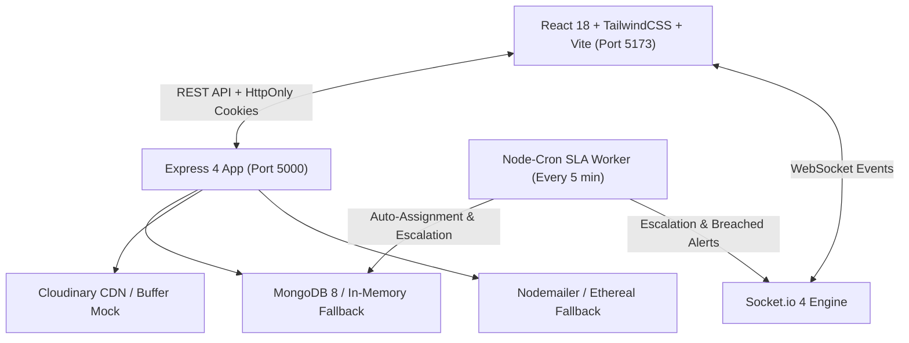

# Smart College Complaint Management System (SmartCMS)

A production-grade, full-stack MERN application for college grievance resolution featuring automated SLA tracking, multi-level auto-escalation cron jobs, atomic "Me Too" deduplication, and dual proof-of-work verification.

Built with **Node.js 20+**, **Express 4**, **MongoDB (Mongoose 8)**, **Socket.io 4**, **node-cron**, **React 18**, and **TailwindCSS**.

---

## 🏛️ System Architecture



---

## ✨ Core Highlights & Features

### 1. Authentication & Role-Based Access Control (RBAC)
- **Roles**: `student`, `staff`, `admin`, `naac`. Staff sub-types: `maintenance` or `department_head`.
- **Dedicated Common Student Login (`/student/login`)**: Tailored portal for all college students across departments (CSE, ECE, MECH, CIVIL) with instant demo accounts.
- **Dedicated College Staff & NAAC Login (`/staff/login`)**: Operations portal for HODs, Technicians, Chief Warden, System Admins, and NAAC Peer Reviewers.
- **Unified Portal (`/login`)**: Tabbed gateway for switching seamlessly between Student Portal and Staff & NAAC Portal.
- **Student Email Constraint**: Self-registration is restricted strictly to `@college.edu` domains, enforced at both the Zod schema level and the `middleware/emailDomain.js` layer.
- **Password Security**: Bcrypt with salt cost 12; enforces 8+ characters, uppercase, lowercase, numbers, and special characters.
- **Session Architecture**: Short-lived access token (15m) in an `HttpOnly`, `SameSite=Lax/Strict` cookie with `Authorization: Bearer` fallback. Refresh Token Rotation (RTR, 7-day expiry) stored as a SHA-256 hash in the database and rotated on every refresh at `/api/auth/refresh`.
- **Brute-Force Protection**: 5 failed login attempts trigger an automatic 15-minute account lock and an audit log entry.

### 2. Smart Complaint Engine & De-Duplication
- **"Me Too" Deduplication**: Debounced MongoDB `$text` search queries against active tickets in the same block/room. Students can upvote existing issues instead of creating duplicate records.
- **Dynamic Priority Bumping**: Upvotes dynamically recalculate a priority score (`baseCategoryWeight + upvotes * 5 + ageFactor`). Crossing thresholds (5 upvotes: medium, 10 upvotes: high, 20 upvotes: emergency) automatically bumps priority and shortens the SLA due date (never extends).
- **Cascading Campus Locations**: Hierarchical structure (`Block -> Floor -> Room`) validated on submission.
- **Anonymity Layer**: Tickets submitted with `isAnonymous: true` strip student contact information from public feeds, staff queues, and admin lists. Revealing identity requires an explicit, audit-logged admin action.

### 3. Dual Proof-of-Work Resolution Verification
- **Photographic Proof**: Staff cannot resolve a complaint without uploading a mandatory work verification photo to Cloudinary.
- **4-Digit Cryptographic OTP**: Resolving marks the ticket as `pending_verification`, generates a cryptographically secure 4-digit OTP (`crypto.randomInt`), hashes it with SHA-256 in the database (with 48h expiry), and dispatches it to the student via email and Socket.io. The raw OTP is never returned in any API response.
- **Confirmation & 5-Star Rating**: The student closes the ticket either by entering their 4-digit OTP or confirming with a 1-5 star rating and review.
- **48-Hour Auto-Close & Reopen Window**: Unverified tickets auto-close after 48h (`verificationMethod: "auto_closed"`). Students can reopen within 48h, which resets the SLA, bumps priority by one tier, and penalizes technician quality metrics.

### 4. SLA & Multi-Level Auto-Escalation Engine
- **SLA Thresholds**:
  - `emergency`: 6 hours
  - `high` / `medium`: 24 hours
  - `low`: 72 hours
- **Automated Cron Cycle (`services/cron.service.js`)**: Runs every 5 minutes with atomic concurrency locks:
  1. Detects unassigned tickets past 25% of SLA and auto-assigns them to the technician with the lightest workload.
  2. Detects breached SLAs and escalates through tiers (Level 1: Department Head, Level 2: Chief Warden / System Admin).
  3. Auto-closes stale `pending_verification` tickets after 48 hours.

### 5. MongoDB Aggregation Analytics
- `/api/admin/analytics/resolution-time`: Average resolution duration in minutes/hours grouped by department.
- `/api/admin/analytics/locations`: Heatmap ranking campus blocks, floors, and rooms by grievance density.
- `/api/admin/analytics/staff-performance`: Technician scorecards with resolved counts, SLA compliance percentage, reopen penalty rates, and average star ratings.
- `/api/admin/analytics/overview`: High-level metrics, breach ratios, and 30-day velocity trends.

### 6. NAAC Severe Grievance Inspection & Action Confirmation Engine
- **On-Site Inspection Visits (`/naac/inspection`)**: Severe safety hazards (electrical sparking, water contamination, lab infrastructure failures) trigger mandatory NAAC Committee inspection visits. The committee records physical inspection observations, verified severity, and visiting officer credentials.
- **Dedicated NAAC Action Confirmation Page (`/complaints/:id/naac-confirm`)**: The NAAC Committee formulates and confirms binding action directives, strict SLA override deadlines (2h, 4h, 8h), and NAAC compliance grade ratings (A++, A+, A).
- **Official Action Confirmation Slip**: Generates a verifiable, cryptographically logged Action Order Slip with unique Slip ID (`NAAC-ACT-2026-XXXX`), institutional seal, authorized signature, and printable/saveable accreditation record.

---

## 📁 Repository Structure

```
├── frontend/                   # Vite + React 18 + TailwindCSS Frontend (Port 5173)
│   ├── src/
│   │   ├── api/axios.js        # Axios instance with credentials and refresh interceptor
│   │   ├── components/         # StatusBadge, PriorityBadge, SlaCountdown, Modals
│   │   ├── context/            # AuthContext, SocketContext
│   │   ├── pages/
│   │   │   ├── student/        # StudentDashboard, NewComplaint, PublicFeed, ComplaintDetails
│   │   │   ├── staff/          # StaffDashboard, StaffPerformance
│   │   │   └── admin/          # AdminDashboard, AdminComplaints, AdminUsers, Departments, AuditLogs
│   │   ├── App.jsx             # Role-based protected routes
│   │   └── index.css           # Glassmorphic utilities, custom scrollbars, Tailwind
│   ├── package.json
│   └── vite.config.js
├── backend/                    # Node.js / Express 4 ES Module Engine (Port 5000)
│   ├── src/
│   │   ├── config/             # db.js, cloudinary.js, jwt.js, env.js, mailer.js
│   │   ├── controllers/        # auth, complaint, staff, admin controllers
│   │   ├── middleware/         # auth, roleCheck, errorHandler, upload, validate, rateLimiter, emailDomain
│   │   ├── models/             # User.js, Complaint.js, Department.js, AuditLog.js
│   │   ├── routes/             # auth, complaint, staff, admin, index routes
│   │   ├── services/           # sla, escalation, notification, otp, audit, analytics, cron services
│   │   ├── utils/              # constants.js, ApiError.js, apiResponse.js, asyncHandler.js, priority.js, generateOtp.js
│   │   ├── app.js              # Security middleware (helmet, cors, sanitize, hpp), routes
│   │   ├── index.js            # HTTP server, Socket.io, graceful shutdown, cron initialization
│   │   └── seed.js             # Database seeder & auto-hydration utility
│   ├── .env.example
│   ├── .env
│   ├── eslint.config.js
│   └── package.json
├── run-all.js                  # Cross-platform runner (starts backend + frontend simultaneously)
├── package.json                # Root orchestrator scripts
└── README.md
```

---

## ⚡ Quick Start & Installation

### Option 1: Run Both Together from Root (Recommended)
```bash
# In the project root folder:
npm start
# OR: npm run dev
# -> Both Backend (http://localhost:5000) and Frontend (http://localhost:5173) start together!
```

### Option 2: Run Separately
```bash
# Terminal 1 - Backend:
npm run backend
# -> Starts on http://localhost:5000

# Terminal 2 - Frontend:
npm run frontend
# -> Starts on http://localhost:5173
```


---

## 🔑 Demo Accounts (Pre-configured)

| Role | Name | Email | Password | Details |
|---|---|---|---|---|
| **Admin** | System Administrator | `admin@college.edu` | `Admin@Password123` | Full access, analytics, user & dept management |
| **NAAC Officer** | Dr. K. Radhakrishnan | `naac.officer@college.edu` | `Naac@Password123` | NAAC Peer Reviewer & IQAC Inspection Authority |
| **Chief Warden** | Dr. Arthur Pendelton | `chief.warden@college.edu` | `Warden@Password123` | Level 2 escalation supervisor |
| **Staff (Head)** | Prof. Vikram Sarabhai | `elec.head@college.edu` | `Staff@Password123` | Electrical Dept Head |
| **Staff (Tech)** | Rajesh Kumar | `elec.tech@college.edu` | `Staff@Password123` | Maintenance Electrician |
| **Student 1 (CSE)** | Alex Johnson | `alex.student@college.edu` | `Student@Password123` | Computer Science student account |
| **Student 2 (ECE)** | Priya Sharma | `priya.student@college.edu` | `Student@Password123` | Electronics student (Ticket awaiting OTP: `4321`) |
| **Student 3 (MECH)** | Rahul Verma | `rahul.student@college.edu` | `Student@Password123` | Mechanical student account |
| **Student 4 (CIVIL)** | Sneha Patel | `sneha.student@college.edu` | `Student@Password123` | Civil Engineering student account |

> **Pro-Tip**: Use `/student/login` for all students, `/staff/login` for all staff & NAAC members, or the unified `/login` portal with 1-click test login buttons.

---

## 📋 Assumptions & Design Decisions

1. **Zero-Dependency Local Fallback**: When `MONGODB_URI` is unreachable or local MongoDB is not installed, the application seamlessly activates `mongodb-memory-server` and hydrates demo data.
2. **Cloudinary Resiliency**: When Cloudinary API credentials are left blank in `.env`, the system provides a local base64/buffer stream mock so proof photo uploads and attachments work cleanly in development.
3. **Email Testing**: In the absence of an external SMTP service, Nodemailer connects to Ethereal Mail, logging email delivery previews to the console.
4. **SLA Deadline Strictness**: Auto-priority bumps triggered by upvotes only shorten deadlines, never extend them.
5. **Immutable Audit Logs**: The `AuditLog` collection is strictly append-only; update and delete routes are deliberately omitted.
